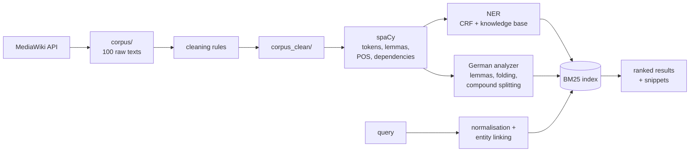

# SpracheNLP

**A search engine for German Wikipedia texts that understands German inflection, compounds, umlauts and names.**


**Live demo:** [blevis.github.io/SpracheNLP](https://blevis.github.io/SpracheNLP/) &nbsp;·&nbsp; **Group 2 (German):** Blevis Allushi, Darsi Ramaj, Geri Belba

A query like *Flüsse in Deutschland* should also find texts that write *Fluss* or *deutschen*. A query typed as *muenchen bier* should find the texts about *München* and *Bier*. Plain word matching misses both. We collected a corpus of 100 German Wikipedia introductions, ran it through an NLP pipeline (cleaning, spaCy, named-entity recognition), and built a BM25 search engine whose analyzer handles the German-specific cases one step at a time. Each step is measured.

| | |
|---|---|
| **Corpus** | 100 texts · 8 topics · 21,059 words · every text pinned to its Wikipedia revision |
| **Named entities** | entity F1 **0.85** (spaCy alone: 0.29) |
| **Search** | nDCG@10 **0.93** (plain word matching: 0.63) on 30 hand-judged queries |

---

## Contents

1. [Submission checklist](#submission-checklist)
2. [Quick start](#quick-start)
3. [How it works](#how-it-works)
4. [Results](#results)
5. [Online version (GitHub Pages)](#online-version-github-pages)
6. [Repository layout and modules](#repository-layout-and-modules)
7. [Commands](#commands)
8. [Corpus choice](#corpus-choice)
9. [Known limits](#known-limits)
10. [Licence](#licence)

---

## Submission checklist

| Requirement | Where to find it |
|---|---|
| **1. Corpus collection** | [`01_corpus.ipynb`](notebooks/01_corpus.ipynb). Raw texts in [`corpus/`](corpus/), cleaned in [`corpus_clean/`](corpus_clean/), sources and licences in [`sources.csv`](sources.csv) |
| **2. NLP preprocessing** | Cleaning, tokenisation, lemmas, POS, dependencies, statistics: [`01_corpus.ipynb`](notebooks/01_corpus.ipynb), sections 3-6. Named entities (BIO): [`02_named_entities.ipynb`](notebooks/02_named_entities.ipynb). Lemmas, folding and compound splitting for search: [`03_search_engine.ipynb`](notebooks/03_search_engine.ipynb), section 2 |
| **3. Application area: search engine** | [`03_search_engine.ipynb`](notebooks/03_search_engine.ipynb), code in [`src/sprache/search/`](src/sprache/search/), evaluated on 30 hand-judged queries in [`data/search/queries.tsv`](data/search/queries.tsv) |
| **4. Weekly progress on GitHub** | The commit history of this repository |
| **5. Presentation** | The web app (`python -m sprache serve`, view *Present*: 9 slides with live numbers and a live demo), also [online](https://blevis.github.io/SpracheNLP/). Plus the three notebooks and the report [`docs/report.pdf`](docs/report.pdf) (corpus part) |

---

## Quick start

```bash
conda env create -f environment.yml      # creates "nlp-de" (Python 3.11) and installs the package
conda activate nlp-de
python -m spacy download de_core_news_md
python -m sprache ner                    # once: trains the NER model (about 1 minute; models/ is not committed)
python -m sprache serve                  # opens http://127.0.0.1:8000
```

The web app uses only the Python standard library and needs no internet, so it also runs on a presentation laptop without network. Startup takes about 15 seconds (spaCy model and index).

| View | What it shows |
|---|---|
| **Present** | The project as 9 slides with live numbers. Arrow keys to move, F for full screen |
| **Search** | Results with the matching words marked and the entities of each text. A panel shows how the query was read (normalisation, lemmas, index terms, linked entities). A side-by-side comparison with plain word matching |
| **Pipeline** | Any German text through cleaning, spaCy (tokens, lemmas, POS, dependencies), index terms and NER (outer and inner BIO), with an option for noisy input |
| **Evaluation** | What each preprocessing step adds, per metric, per kind of query and per query |
| **Corpus** | All 100 texts with their named entities, source revision and licence |

<details>
<summary>Without conda, or if the install fails</summary>

- Run `pip install -r requirements.txt` inside a Python 3.10-3.12 virtual environment, then download the spaCy model as above.
- On Windows, if the spaCy install fails while compiling, install the Visual C++ Build Tools first (lab sheet, section 2.5).
- NLTK downloads its German sentence model (`punkt_tab`) on first use. On an offline machine, run `python -m nltk.downloader punkt_tab` once beforehand.

</details>

---

## How it works



The project has three parts, one notebook each. The notebooks only call the code in `src/sprache/`.

**Part 1: corpus and preprocessing** ([`01_corpus.ipynb`](notebooks/01_corpus.ipynb))
- Downloads article introductions through the official MediaWiki API, 20 titles per request, cut at sentence boundaries to 100-300 words.
- Quality checks found template artefacts in 22 texts (IPA, empty brackets, dangling language labels). Named, tested regex rules remove them.
- spaCy analysis: tokens, lemmas, POS, dependencies, corpus statistics, and probes for German-specific cases (compounds, contractions, separable verbs).

**Part 2: named entities** ([`02_named_entities.ipynb`](notebooks/02_named_entities.ipynb))
- BIO tagging of names (ENAMEX), amounts (NUMEX) and dates (TIMEX), with a second layer for nested entities.
- Training labels come from distant supervision: Wikipedia links plus Wikidata types form a knowledge base, and every link is propagated to every mention of that name.
- An NLTK CRF tagger with gazetteer dropout, a chunk grammar for amounts and dates, metonymy rules from the dependency parse, and a normaliser for noisy input.

**Part 3: search engine** ([`03_search_engine.ipynb`](notebooks/03_search_engine.ipynb))
- BM25 ranking (k1 = 1.2, b = 0.75, title words weighted 3x).
- The analyzer removes stop words, maps words to lemmas (names keep their form), folds umlauts and case, and splits compounds using the corpus's own vocabulary and German linking elements, so *Landeshauptstadt* is also indexed as *Hauptstadt* and *Regierungsbezirks* as *Bezirk*.
- Entity terms from Part 2 link every mention of a name to one knowledge-base entry, so a query name matches the entity however a text writes it.
- Queries are normalised first (*muenchen* becomes *München*). When a word is unknown, a back-off chain tries the lemma, then the word form, then the compound parts.

---

## Results

### Named entities

Entity-level F1 on 8 hand-checked texts (exact span and type):

| System | Names (ENAMEX) | Amounts (NUMEX) | Dates (TIMEX) | All |
|---|---|---|---|---|
| spaCy `de_core_news_md` alone | 0.35 | – | – | 0.29 |
| **Our pipeline** | **0.80** | **0.95** | **1.00** | **0.85** |

On noisy text (lower case, no umlauts, typos) F1 drops to 0.46. Normalisation brings it back to 0.82. The gold standard is small (204 entities, one annotator).

### Search engine

Each row adds one preprocessing step to the row above. Evaluated on 30 test queries:

| System | nDCG@10 | MRR |
|---|---|---|
| Surface word forms (baseline) | 0.63 | 0.74 |
| + stop words removed | 0.63 | 0.74 |
| + lemmas | 0.72 | 0.80 |
| + umlaut and case folding | 0.86 | 0.93 |
| + compound splitting | 0.89 | 0.93 |
| + entity linking (from Part 2) | 0.90 | 0.93 |
| **+ query normalisation (full system)** | **0.93** | **0.97** |

We wrote and judged the queries ourselves, so the absolute numbers are optimistic. The meaningful part is the difference between steps. Known failure: derivation (*Radioaktivität* does not find *radioaktiv*). Details and error analysis are in [`03_search_engine.ipynb`](notebooks/03_search_engine.ipynb).

---

## Online version (GitHub Pages)

GitHub Pages only hosts static files, so `python -m sprache export-site` writes a static copy of the web app to `site/`.

- **Precomputed in Python and saved as JSON:** the index, the analyzer's resources, the documents, the slide numbers, the evaluation and the Pipeline examples.
- **Run in the browser:** `static-engine.js` repeats the query side in JavaScript: normalisation, lemma lookup, the analyzer and its back-off chain, entity linking, BM25 and snippets.
- **Differences from the local app:**
  - A query word's lemma comes from a table of every word form in the corpus instead of from spaCy.
  - The Pipeline view only shows its four example texts.
- **Parity check:** when Node.js is installed, the export compares both engines. They rank all 30 test queries identically (nDCG@10 0.93 in both).

**Deploy (once):**

1. Run `python -m sprache export-site`. To preview it, run `python -m http.server -d site 8001` and open `http://127.0.0.1:8001/`.
2. Commit `site/` and `.github/workflows/pages.yml`, and push to `main`.
3. On GitHub, go to *Settings* → *Pages* → *Build and deployment* → *Source* and choose **GitHub Actions**.
4. Wait for the "Deploy site to GitHub Pages" run in the *Actions* tab. The site is then at `https://blevis.github.io/SpracheNLP/`.

The workflow only uploads `site/`, so it runs in seconds and needs no Python. After changing the corpus or the code, run `export-site` again and push. On a free GitHub account, Pages needs a public repository.

---

## Repository layout and modules

| Path | What it is |
|---|---|
| `notebooks/` | The three parts: [`01_corpus`](notebooks/01_corpus.ipynb), [`02_named_entities`](notebooks/02_named_entities.ipynb), [`03_search_engine`](notebooks/03_search_engine.ipynb). Each section heading names its owner |
| `src/sprache/` | All code, one module per step (tables below) |
| `src/sprache/web/` | The web app (`server.py`, standard library), its page (`static/`) and the static export (`export.py`, `site/static-engine.js`) |
| `corpus/`, `corpus_clean/` | The texts as returned by the API, and after cleaning (UTF-8, 100-300 words each). Generated, committed |
| `sources.csv` | One row per text: topic, title, URL, revision link and id, retrieval and last-modified dates, licence, word count |
| `data/titles.txt` | Candidate article titles by topic. **Edit this to grow the corpus** |
| `data/skipped.csv` | Titles rejected in the last build, with the reason |
| `data/ner/` | Knowledge base (`links.csv`, `kb.csv`), automatic labels (`silver.conll`), hand-checked labels for 8 texts (`gold.conll`), test sentences (`challenge.txt`), the corpus entity index (`entities.csv`) |
| `data/search/queries.tsv` | 30 test queries with hand-made relevance judgments |
| `figures/` | displaCy dependency trees and entity views. Generated |
| `site/` | Static copy of the web app for GitHub Pages. Generated by `export-site`, committed |
| `.github/workflows/pages.yml` | Publishes `site/` to GitHub Pages on every push to `main` |
| `docs/` | LaTeX report on the corpus part (`report.tex`, `report.pdf`). Its numbers and tables come from `docs/generated/` |
| `tests/` | pytest suite: unit tests per module, integrity checks on the committed data, model tests |
| `models/` | Trained CRF models and the cached spaCy parse of the search index. Generated, git-ignored |

<details>
<summary><b>Corpus modules</b> (<code>src/sprache/</code>)</summary>

| Module | Responsibility |
|---|---|
| `config.py` | Every path, limit and setting in one place |
| `fetch.py` | MediaWiki API client: 20 titles per request, retry and back-off on HTTP 429/5xx, `maxlag`, redirects, disambiguation detection |
| `corpus.py` | Reads `titles.txt`, picks titles round-robin across topics, cuts texts at sentence boundaries, writes and loads the corpus |
| `clean.py` | Named, two-phase regex cleaning rules, tested on real examples |
| `quality.py` | Pattern checks (IPA, mojibake, markup, empty brackets and more), repeated, English and near-duplicate texts |
| `stats.py` | Token, type, lemma and stop-word statistics, top-n tables, per-topic and raw-vs-clean comparisons |
| `analysis.py` | Token tables, displaCy export, German-specific probes (compounds, contractions, separable verbs) |
| `report.py` | Writes the LaTeX numbers, tables and dependency trees for `docs/report.tex`, and compiles the PDF |

</details>

<details>
<summary><b>NER modules</b> (<code>src/sprache/ner/</code>)</summary>

| Module | Responsibility |
|---|---|
| `text.py` | NLTK Punkt (German) sentence splitting and word tokenisation, with fixes for German abbreviations and number ranges |
| `bio.py` | BIO tags, entity spans, NLTK chunk trees, the two layers for nested entities |
| `kb.py` | Knowledge base from Wikipedia links and Wikidata types (distant supervision). Lookup tolerates case, umlauts, genitive and inflection |
| `rules.py` | NUMEX and TIMEX with a cascaded `nltk.RegexpParser` chunk grammar |
| `silver.py` | Automatic BIO labels: links propagated to every mention, spaCy entities for unlinked proper nouns, the chunk grammar |
| `features.py`, `tagger.py` | CRF features (shape, affixes, POS, gazetteer, spaCy's label, ±2 window) and NLTK `CRFTagger` with gazetteer dropout |
| `context.py` | Type ambiguity, metonymy from the dependency parse, nesting, canonical names |
| `noise.py` | Noise simulation and normalisation (truecasing, umlaut restoration, typo repair with `nltk.edit_distance`) |
| `pipeline.py` | Text in, outer and inner BIO and an entity table out |
| `evaluate.py`, `experiments.py` | Entity-level P/R/F1, system comparison, challenge set, noise robustness, learning curve, the corpus index |

</details>

<details>
<summary><b>Search modules</b> (<code>src/sprache/search/</code>)</summary>

| Module | Responsibility |
|---|---|
| `text.py` | German analyzer: stop words, lemmas (names keep their form), umlaut and case folding, corpus-driven compound splitter with linking elements |
| `engine.py` | Inverted index with BM25, entity terms from `entities.csv`, query processing (normalisation, back-off, entity linking), snippets |
| `evaluate.py` | P@5, R@10, MRR, nDCG@10, and the ablation over the preprocessing steps |

</details>

---

## Commands

The corpus and the knowledge base are **committed (frozen)**, so everything runs offline and gives the same results on every machine.

**Everyday**

| Command | What it does |
|---|---|
| `python -m sprache serve` | The web app (search and presentation). Options: `--port 8080`, `--no-browser` |
| `python -m sprache search "Flüsse in Deutschland"` | Search from the terminal |
| `python -m sprache search-eval` | Search evaluation: ablation, per kind of query, per query |
| `python -m sprache ner-tag "Berlin lehnt den Vorschlag ab."` | Tag your own text. Add `--noisy` for lower-case or umlaut-less input |
| `python -m sprache export-site` | Write the static site to `site/`, and check that the JavaScript engine ranks like the Python engine |
| `python -m pytest` | Run the tests (102 tests, about 20 s) |

<details>
<summary><b>Rebuilding</b></summary>

| Command | What it does |
|---|---|
| `python -m sprache build` | Re-download `corpus/` and `sources.csv` (needs internet, about 10 s) |
| `python -m sprache clean` | Regenerate `corpus_clean/` from `corpus/` |
| `python -m sprache check` | Quality report, raw vs. clean |
| `python -m sprache stats` | Corpus statistics in the terminal |
| `python -m sprache figures` | Regenerate the displaCy figures |
| `python -m sprache ner-kb` | Re-download the knowledge base into `data/ner/` (needs internet, about 1 minute) |
| `python -m sprache ner` | Silver labels, train the CRF, tag the corpus, write `data/ner/entities.csv` (about 1 minute) |
| `python -m sprache ner-eval` | All NER evaluations in the terminal (about 2 minutes) |
| `python -m sprache notebook` | Execute all three notebooks in place (headless) |
| `python -m sprache report --pdf` | Regenerate `docs/generated/` and compile `docs/report.pdf`. Needs LuaLaTeX (MiKTeX or TeX Live) and the Cambria and Consolas fonts (standard on Windows). Otherwise compile `docs/` on Overleaf after changing the two font lines |
| `python -m sprache all` | The full rebuild: build, clean, figures, ner, notebooks, report |

</details>

<details>
<summary><b>Growing the corpus</b></summary>

1. Add titles to `data/titles.txt` under a `## topic` heading. To change the size, raise `MAX_TEXTS` in `src/sprache/config.py` or run `python -m sprache build --max-texts 200`.
2. Run `python -m sprache all`, then `python -m pytest`.
3. If `test_pinned_sentences_still_in_corpus` fails, an article changed on Wikipedia. Pick new sentences in `config.PINNED_SENTENCES` and **re-check the verdicts in section 5 of the first notebook by hand**: they are written for those exact sentences.
4. Re-check the relevance judgments in `data/search/queries.tsv`, because new texts may be relevant to existing queries.

</details>

---

## Corpus choice

**Used: introductions of German Wikipedia articles.**
- **Licence:** CC BY-SA 4.0 (attribution and share-alike). The lab sheet names Wikipedia as a safe choice.
- **Access:** the official MediaWiki API (`de.wikipedia.org/w/api.php`), not scraping. Requests are batched and respect rate limits.
- **Fit:** coherent, self-contained texts of the length the lab asks for (100-300 words). Every text is pinned to an exact revision (`permalink` in `sources.csv`), so the corpus is reproducible.

<details>
<summary>Alternatives we checked</summary>

The licences below are as stated on the providers' pages when we looked them up. Re-check them before relying on them.

| Source | Content | Licence | Fit for this lab |
|---|---|---|---|
| Leipzig Corpora Collection (wortschatz.uni-leipzig.de) | German news and web text, plain-text sentence lists | Downloadable corpora: CC BY | The sentences are shuffled, so there are no coherent texts. Useful for frequency work, not as the main corpus |
| Deutsches Textarchiv (deutschestextarchiv.de) | Historical German, 1600-1900 | Core corpus CC BY-NC(-SA); some parts CC BY-SA 4.0 | Usable only under non-commercial terms. The old spelling makes the modern model perform badly |
| German Wikinews | Short news articles | Believed CC BY 2.5, **not verified** | Possible source for news texts. Verify the licence first |

</details>

---

## Known limits

- **Cleaning:** the rules target the artefacts found in this corpus. New articles may produce new patterns, so run `python -m sprache check` after every rebuild. Greek and Hebrew etymologies are kept on purpose; they still appear as "non-Latin script" in the clean report.
- **Corpus:** Wikipedia introductions are formal and encyclopedic, so the corpus does not represent everyday German.
- **NER:** metonymy hardly occurs in encyclopedic text, so it is measured on a hand-written challenge set. Noise is simulated, not taken from real social media. The knowledge base inherits Wikidata's classification (for example, the EU is a GPE).
- **Search:** no derivation (*Radioaktivität* / *radioaktiv*) and no synonyms (*Dichter* / *Schriftsteller*). The compound splitter only knows words that occur in the corpus. The entity terms inherit the NER errors.

---

## Licence

The texts in `corpus/` and `corpus_clean/` come from German Wikipedia and remain under CC BY-SA 4.0. Their authors are listed in the version history behind each permanent link in `sources.csv`.
